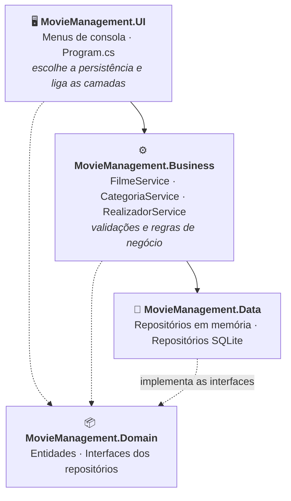
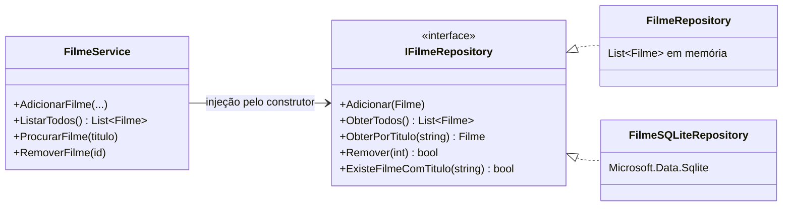
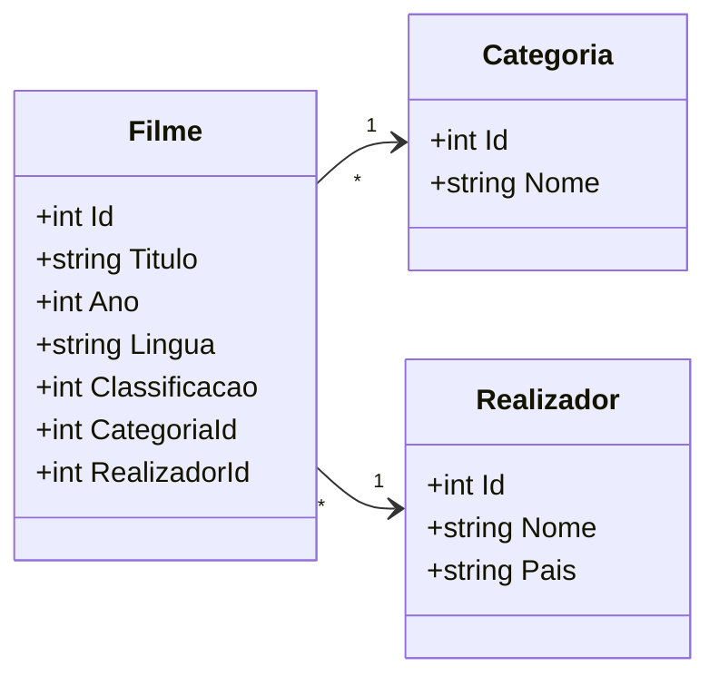

# 🎬 MovieManagement

> Aplicação de gestão de filmes desenvolvida em C# com arquitetura em camadas, persistência dual (memória + SQLite) e boas práticas de desenvolvimento.


---

## 📋 Índice

- [Sobre o Projeto](#-sobre-o-projeto)
- [Arquitetura](#-arquitetura)
- [Modelo de domínio](#-modelo-de-domínio)
- [Tecnologias](#-tecnologias)
- [Funcionalidades](#-funcionalidades)
- [Regras de Negócio](#-regras-de-negócio)
- [Persistência](#-persistência)
- [Como Executar](#-como-executar)
- [Estrutura do Projeto](#-estrutura-do-projeto)

---

## 🎯 Sobre o Projeto

O **MovieManagement** é uma aplicação de consola em C# que permite gerir filmes, categorias e realizadores. Desenvolvido com foco em **arquitetura em camadas**, **interfaces**, **regras de negócio** e **persistência de dados**, o projeto demonstra a separação clara de responsabilidades entre as camadas de uma aplicação empresarial.

---

## 🏗️ Arquitetura

O projeto segue uma arquitetura em 4 camadas:

```
MovieManagement
│
├── MovieManagement.UI          → Interação com o utilizador (menus, input/output)
├── MovieManagement.Business    → Regras de negócio e validações
├── MovieManagement.Data        → Persistência (memória e SQLite)
└── MovieManagement.Domain      → Entidades e interfaces (contratos)
```

As dependências entre camadas:



Os services recebem as **interfaces** (`IFilmeRepository`, `ICategoriaRepository`, `IRealizadorRepository`) pelo construtor e não conhecem a implementação concreta:



> A arquitetura permite **trocar a implementação de persistência sem alterar** a camada UI, Business ou Domain, basta substituir o repositório injetado.

---

## 🧩 Modelo de domínio



---

## 🛠️ Tecnologias

- **C# / .NET 10**
- **Microsoft.Data.Sqlite** — persistência em base de dados
- **Arquitetura em Camadas** — separação de responsabilidades
- **Interfaces** — contratos entre camadas
- **Injeção de Dependência** — manual, via construtores

---

## ✅ Funcionalidades

### 🎬 Filmes
| Funcionalidade | Descrição |
|---|---|
| Adicionar | Regista um novo filme com categoria e realizador |
| Listar | Exibe todos os filmes com os dados completos |
| Procurar | Pesquisa filme por título (case-insensitive) |
| Remover | Remove filme pelo ID |

### 🏷️ Categorias
| Funcionalidade | Descrição |
|---|---|
| Adicionar | Regista uma nova categoria |
| Listar | Exibe todas as categorias |
| Procurar | Pesquisa categoria por nome |
| Remover | Remove categoria pelo ID |

### 🎥 Realizadores
| Funcionalidade | Descrição |
|---|---|
| Adicionar | Regista um novo realizador com nome e país |
| Listar | Exibe todos os realizadores |
| Procurar | Pesquisa realizador por nome |
| Remover | Remove realizador pelo ID |

---

## 📐 Regras de Negócio

Todas as validações são aplicadas na **camada Business**:

**Filme**
- Título obrigatório e único (sem duplicados)
- Classificação entre **0 e 5**
- A categoria indicada deve existir antes de adicionar o filme
- O realizador indicado deve existir antes de adicionar o filme

**Categoria**
- Nome obrigatório
- Não são permitidas categorias duplicadas

**Realizador**
- Nome obrigatório
- País obrigatório

---

## 💾 Persistência

No arranque da aplicação é possível escolher o tipo de persistência:

```
Escolha o tipo de persistência:
1 - Memória
2 - SQLite
```

| Modo | Implementação | Comportamento |
|---|---|---|
| **Memória** | `List<T>` | Dados perdidos ao fechar a aplicação |
| **SQLite** | `Microsoft.Data.Sqlite` | Dados persistidos em `moviemanagement.db` |

A troca é transparente para toda a aplicação — apenas o `Program.cs` instancia repositórios diferentes; o resto do código não muda.

---

## ▶️ Como Executar

**Pré-requisitos:** .NET 10 SDK instalado.

```bash
# Clonar o repositório
git clone https://github.com/hannasampaio/MovieManagement.git

# Entrar na pasta da solução
cd MovieManagement

# Executar
dotnet run --project MovieManagement.UI
```

Ao iniciar, escolhe o modo de persistência e navega pelos menus:

```
╔══════════════════════════╗
║       MOVIE MANAGEMENT   ║
╚══════════════════════════╝
1 - Menu Filmes
2 - Menu Categorias
3 - Menu Realizadores
0 - Sair
```

> 💡 **Dica:** Para usar filmes com categoria e realizador, começa sempre por registar uma categoria e um realizador antes de adicionar filmes.

---

## 📁 Estrutura do Projeto

```
MovieManagement/
│
├── MovieManagement.UI/
│   └── Program.cs                        # Menus e interação com o utilizador
│
├── MovieManagement.Business/
│   └── Services/
│       ├── FilmeService.cs               # Lógica de negócio dos filmes
│       ├── CategoriaService.cs           # Lógica de negócio das categorias
│       └── RealizadorService.cs          # Lógica de negócio dos realizadores
│
├── MovieManagement.Data/
│   └── Repositories/
│       ├── FilmeRepository.cs            # Persistência em memória (filmes)
│       ├── CategoriaRepository.cs        # Persistência em memória (categorias)
│       ├── RealizadorRepository.cs       # Persistência em memória (realizadores)
│       ├── FilmeSQLiteRepository.cs      # Persistência SQLite (filmes)
│       ├── CategoriaSQLiteRepository.cs  # Persistência SQLite (categorias)
│       └── RealizadorSQLiteRepository.cs # Persistência SQLite (realizadores)
│
└── MovieManagement.Domain/
    ├── Entities/
    │   ├── Filme.cs                      # Entidade Filme
    │   ├── Categoria.cs                  # Entidade Categoria
    │   └── Realizador.cs                 # Entidade Realizador
    └── Interfaces/
        ├── IFilmeRepository.cs           # Contrato do repositório de filmes
        ├── ICategoriaRepository.cs       # Contrato do repositório de categorias
        └── IRealizadorRepository.cs      # Contrato do repositório de realizadores
```

---

*Projeto desenvolvido no âmbito da formação Software Developer 2026 (CESAE Digital).*

Desenvolvido por **Hanna Sampaio** · [LinkedIn](https://www.linkedin.com/in/hannasampaio7/) · [GitHub](https://github.com/hannasampaio)
